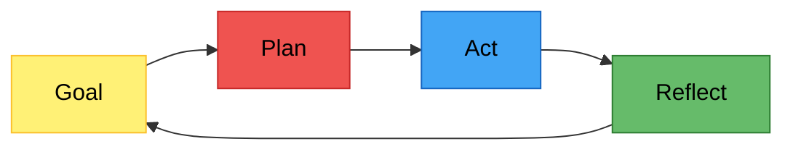

## Notes

### Types of AI for Coding
There are many types of AI usage for coding:
- Chat interface: Asking questions, no code context
- IDE code completion: Suggestion as you type, a la intellisense, LSP completion, etc.
- "Ask" inside an IDE: Right-click and ask about a piece of code. Good for small, localized updates
- IDE chat: Refined questions with code context
- IDE AI Agent: Good for larger changes in a project
- AI Agent CLI or desktop: Similar to IDE AI Agent, but outside an IDE. Can often do more since it's not constrained by the IDE (multiple projects, terminal commands, etc.)
Use the right tool for the job:
- Tiny edits -> fix it myself
- Too ambiguous -> Do it myself or explore the problem more first
- I'm not familiar with the codebase -> Become familiar with it first. Then implement context, guardrails, etc. for the agent.
### Context
[[#^good-types-of-context|Good context]]
- Improves the outcome
- Guides the agent
- Decreases how much it needs to explore
Too much context slows it down and may confuse it

A good AGENTS.md file can provide the agent with both behavioral and content context, helping to guide it and ensuring it works as desired.

### Prompt Engineering
The initial prompt is important. Vague questions lead to assumptions, wrong scoping, or moving too quickly.
Instead, Provide proper framing
- Provide the ticket/issue
- List assumptions
- Identify unknowns
- Suggest a plan (or work with it to come up with a plan)
Have the agent restate the task before it starts to iron out any misunderstandings.

### Tools
#### LSPs
[[Language Server Protocol|LSPs]] can help provide context about the codebase. They'll provide structural information, lints, and other information.

#### Plugins (esp. Agentic)
Plugins can help manage agentic loops and manage context. Agentic plugins can hook into the agent CLI and control the loop. Others can provide the agent with more information and help guide it.

#### MCP
[[Model Context Protocol|MCP]] servers allow the agent to connect to other services and systems outside the repository. This effectively moves it out of the CLI/file world into interacting with more complex tools, such as databases, webpages, etc.

MCPs are a double-edged sword: they can make the agent far more powerful and able to work in diverse workflows, but they can also cause security issues, bloat the context, and give misguide the agent.

#### Skills
Skills are useful for guiding the agent to do something specific. They can be used to encode a workflow or provide references to other information. They are most useful for helping the agent understand why something is set up in a specific way and following a repeatable process.

#### Agent Tools
Agent tools are tools in the CLI that the agent can call, similar to [[#MCP]] but without the need for a server. These can be used to automate a common set of steps, generate documents, or perform other tasks that are better suited for deterministic code.

### Model Choice
Different LLMs have different training, are tuned for different tasks, or simply do better. Choosing the right agent for the right tasks can help produce a better output.

This field is developing rapidly though, so it can be difficult to determine the correct model. There are many benchmarks online providing information about different models, and it can often be worth experimenting to see what works best.

## Thoughts
- How can I ensure my agents are properly following the [[#^agent-loop]]?
- One of the tricky points I've encountered is delivering proper [[#^good-types-of-context|intent context]]. When I split jobs into tickets for the agents, they often don't see the full picture and fail to design with that in mind. When compaction occurs, they also lose intent. This is particularly problematic with "eager/wild" agents like Nemotron.
- Regarding [[#LSPs]], OpenCode 2 removed support. It's not clear if they intend to re-add it, but it sound like they're shifting towards linters and static tools instead.
    - I've noticed agents seem to get a little side-tracked when fed LSP information constantly. Maybe it's good they've removed it?
## Quotes
> [!QUOTE] The Agent Loop
> This loop is what separates an agent from a simple chat — it can plan work, execute it, and evaluate the result before continuing. 

^agent-loop

> [!QUOTE] Good types of Context
> **Behavior** — Let your agent select skills, or instruct it directly, to give it a behavior and work-mode context.
> **Content** — Construct an agents.md or use a tool that creates a graph of your data to give it a content context.
> **External** — Give your agent access to external systems (via MCP) to extend the content context.
> **Intent** — Add an agent session memory tool to give it an intent context.
^good-types-of-context