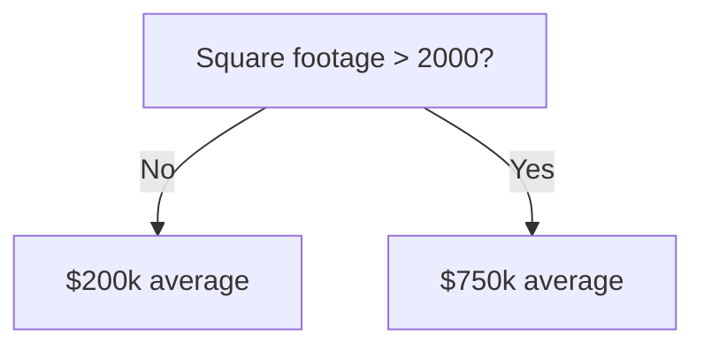

## Definition
A *decision tree* is a [[Supervised Learning]] model that learns a tree structure of decision rules from training data. Each internal node tests a feature, each branch represents a test outcome, and each leaf node provides a prediction. The algorithm automatically determines which features to test and in what order by analyzing the training data.

## Example
To predict house prices, a decision tree might learn:

The tree learned from training data that square footage is a strong predictor, and calculated average prices for houses above/below 2000 sq ft.