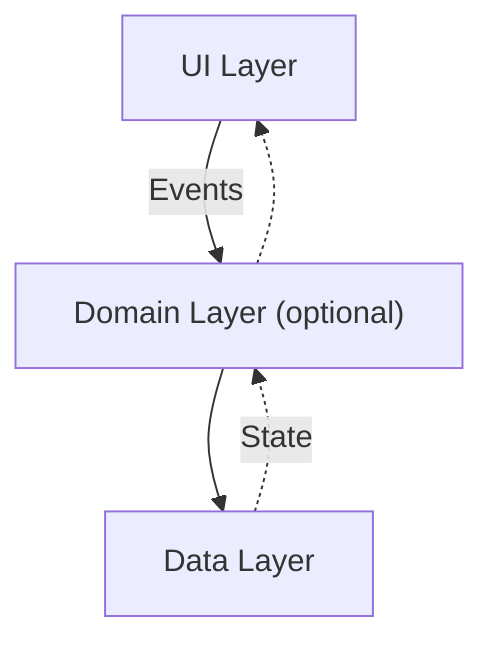

Android applications should have at least two layers: the [[UI Layer]] and the [[Data Layer]]. The UI layer should display data to the user, and the data layer should control the business logic and controls the application data. Sometimes, it can be beneficial to have a third [[Domain Layer]], which can provide simplified and reusable interactions between the UI and data layer similar to a [[Facade]].

To manage dependencies between components, use either the [[Dependency Injection]] or [[Service Locator]] pattern. These allow easier testing, cleaner code, better traceability, easier debugging, and better adaptability.

Android [recommends]( https://developer.android.com/topic/architecture#best-practices) these general tips:
- Don't store data in app components
- Reduce dependency on Android classes. Write wrappers and abstractions instead.
- Define clear boundaries of responsibilities between modules
- Expose as little as possible from each module
- Focus on the unique core of the app. Don't reinvent the wheel.
- Use [[Canonical Layouts|canonical layouts]] and [app design patterns](https://developer.android.com/design/ui/gallery)
- Preserve UI state (use [[View Model]])
- Design reusable and composable UI components ([[DRY]])
- Make each part of the app testable in isolation
- Types are responsible for their concurrency policy. That is, allow the type to manage its work and threads instead of managing it outside the type. Type type should know best.
- Persist as much relevant and fresh data as possible. This helps the app work when offline.
